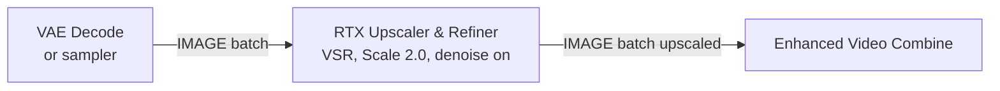

# RTX Upscaler & Refiner

The visible name has no DaSiWa prefix; saved/API node ID `DaSiWa_RTX_UpscalerRefiner`, execution interface and existing JavaScript registration target are unchanged. For separate temporal interpolation see [RTX Frame Generation](rtx_frame_generation.md).

NVIDIA VFX enhancement for image and video batches, with optional Denoise, Deblur, Upscale and TrueHDR passes in one node. Processing uses bounded frame windows and returns one standard ComfyUI `IMAGE` batch. The node keeps its own `DaSiWa_RTX_UpscalerRefiner` ID and can coexist with Comfy-Org's NVIDIA VFX nodes; it does not replace or patch them.

> **Fix (v0.4.13):** `empty_cache` is now an **optional** input with a default of `False`. It had previously been a required positional input, which broke API workflows that did not pass it (fixes #24). Existing workflows are unaffected — the default preserves the original behavior.

## ⚡ Processing Pipeline
The node executes effects in this order:
1.  **Denoise (Pass 1):** Cleans up grain and compression artifacts at the source resolution.
2.  **Deblur (Pass 2):** Sharpens focus and reduces motion blur at the source resolution.
3.  **Upscale (Pass 3):** Scales the image to the target resolution using AI (VSR, High Bitrate or an available Streaming mode).
4.  **TrueHDR (optional final pass):** Converts the final SDR RGB frame to normalized BT.2020/PQ HDR values. Disabled by default; it can also run without Denoise, Deblur or Upscale.

## SDK capabilities, precision and HDR

The node uses the installed `nvidia-vfx` package (`nvvfx`) and detects available effects, quality levels and constructor parameters without loading an effect during schema discovery. Newer APIs are used when installed; supported older VSR APIs remain usable. There is no automatic package installation or live SDK switching. Restart ComfyUI after changing the package. API availability does not guarantee GPU/driver support for inference.

- **10-bit SDK encoding** is optional. RGB10A2 packs RGB into 10-bit channels for SDK processing; intermediate results are unpacked before ordinary resizing or another processing pass. It does not turn SDR into HDR, restore precision already lost in an 8-bit source, or reduce the complete float IMAGE batch's memory footprint.
- **TrueHDR** is a separate opt-in decision. Its packed output is unpacked into a normal ComfyUI IMAGE tensor, but the values remain BT.2020/PQ rather than SDR/sRGB. Available SDK controls cover contrast, saturation, middle gray, target luminance and debanding.
- **HDR export:** IMAGE carries no transfer-function or color-primary metadata. The saver must explicitly encode and tag BT.2020/PQ, normally using a suitable 10-bit video format. Enhanced Video Combine is not yet verified for this HDR export contract; ordinary SDR previews or saves must not be interpreted as proof of valid HDR output.
- Unsupported features requested by an API prompt must fail clearly instead of silently substituting 8-bit or SDR processing. Existing DaSiWa registration and old input/output positions remain unchanged; the official Comfy-Org pack can remain installed.
- This node does not change frame count or FPS and does not replace RIFE interpolation.

## Upscale modes and input contract

Input is an ordered `IMAGE` batch of still images or decoded video frames, not a native `VIDEO` object. Frame count/order are unchanged. Audio and FPS must be routed separately from the loader to the encoder. A native VIDEO mode is only a proposal, not an implemented interface. Every required and optional control has native hover help.

| `upscale` | Meaning |
| --- | --- |
| Off | Skip the upscale pass and retain source dimensions. All target-size and resize controls are ignored; other enabled effects still run. |
| VSR | Standard SDK reconstruction for typical compressed sources, using `upscale_quality`. |
| High Bitrate | SDK high-bitrate reconstruction for cleaner, high-bitrate/lossless sources, using `upscale_quality`. This does not set export bitrate. |
| Streaming Medium | Capability-gated SDK streaming quality preset; ignores `upscale_quality`. |
| Streaming Ultra | Capability-gated higher streaming quality preset; ignores `upscale_quality`. |

**Streaming here names SDK presets, not streaming file I/O.** Both still consume/return complete IMAGE batches. They do not bound total video memory or pass through audio. Compare results on the actual source rather than assuming one mode always looks better.

## 📐 Resize Types Explained

Choosing the right `resize_type` is key to getting the correct output resolution:

*   **Same Size:** The node processes the input at its original resolution. Use this if you only want to Denoise or Deblur without changing the size.
*   **Scale:** Simply multiplies the current width and height by the `scale` value. For example, a 1080p image at 2.0x scale becomes 4K.
*   **Keep Ratio:** Targets the `megapixels` budget and source aspect ratio; divisibility can approximate the area and ratio. It can downscale when the budget is below source area.
*   **Preset Ratio:** Targets the `megapixels` budget but forces the image into a specific shape (like `16:9` or `9:16`) regardless of the input. Use `resize_method` to decide if the image should be cropped or letterboxed to fit.
*   **Manual:** Uses `width` and `height` in pixels, rounded to `divisible_by`.

These controls apply only when `upscale` is not Off. `scale` is used only by Scale; `megapixels` only by Keep Ratio/Preset Ratio; `ratio_preset` only by Preset Ratio; width/height only by Manual. Same Size retains exact source dimensions and ignores `divisible_by`; the other modes use the selected alignment. `resize_method` handles aspect mismatches: Center Crop (Fill) removes centered edges, while Letterbox (Fit) retains the full source and adds black bars. It does nothing for matching aspects.

## 💎 Quality Levels (Low to Ultra)

Quality selects the corresponding installed SDK tier for each stage:
* **Low:** Speed-oriented tier.
* **Medium:** Middle tier.
* **High:** Quality-oriented tier.
* **Ultra (Default):** Highest exposed tier.

Denoise/Deblur quality and strength matter only when their stage is enabled. Upscale quality applies to VSR and High Bitrate, not Off or Streaming presets. Strength changes do not enable skipped stages. Higher tiers may cost more compute but do not guarantee recovered detail, better output on every source, or a particular model parameter count.

## ⚠️ When Results Can Look Worse

RTX VSR is an upscaler, not a detail recovery tool for material that has already been enlarged. If the input video was previously upscaled, heavily sharpened, denoised, or re-encoded, RTX VSR may enhance those artifacts instead of creating real new detail. This can look pixelated, smeared, or over-processed.

Check these settings first when users report degraded quality:

*   **Target resolution below input:** `Keep Ratio` uses the `megapixels` value. For example, a 4K input is about 8.3 MP, so `Keep Ratio` at `2.0` MP is a downscale and will look softer.
*   **Manual size below input:** Manual `1920x1080` on a 4K source is also a downscale.
*   **Divisibility too high:** `divisible_by=8` matches RTX VSR behavior and common video sizes like 3840x2160. Use `32` only for downstream nodes that require it, because standard 2160p is not divisible by 32.
*   **Aspect changes:** `Preset Ratio` and mismatched `Manual` dimensions intentionally crop or letterbox before upscaling. Use `Scale` or `Keep Ratio` when you want to preserve the source framing.
*   **Too many cleanup passes:** Denoise and Deblur can help poor sources, but on already clean video they may remove texture before the upscale pass.

## ⚙️ Key Parameters

| Parameter | Description |
| :--- | :--- |
| **upscale** | `VSR` handles typical compressed sources. `High Bitrate` is tuned for clean, high-bitrate or lossless sources and avoids unnecessary artifact suppression. |
| **image_encoding** | `8-bit RGB` by default; optional `10-bit RGB (RGB10A2)` when supported. VFX output starts in FP32 for the 10-bit path. |
| **denoise_strength / deblur_strength / upscale_strength** | Independent SDK effect strengths, 0–1, default 1.0. Available when the installed VSR constructor supports strength. |
| **preserve_alpha** | Off by default to retain the legacy RGB output. On preserves input alpha through the same crop/letterbox and spatial resize, without SDK filtering. |
| **channel_integrity_check** | Off by default. Checks small samples before clamp for NaN/Inf and suspicious SDR channel collapse. It is a heuristic and may flag legitimate color changes; HDR only receives the finite-value check. |
| **hdr_enabled** | Off by default; available with TrueHDR. Final PQ/BT.2020 conversion, also usable by itself. |
| **hdr_contrast** | Light/dark separation control, 0–200, default 100; active only with HDR enabled. |
| **hdr_saturation** | Color intensity control, 0–200, default 100; active only with HDR enabled. |
| **hdr_middle_gray** | Midtone brightness reference, 10–100, default 50; not the peak luminance setting. Active only with HDR enabled. |
| **hdr_luminance** | Target peak luminance 400–2000 nits, default 650; active only with HDR enabled. |
| **hdr_debanding** | On by default; enables the SDK DL-Debander to reduce banding. Off disables it; active only with HDR enabled. |
| **divisible_by** | Use **8** for RTX-style image/video upscaling. Use **32** only when the next model in the workflow requires it. |
| **resize_method** | When the source and target aspect ratios don't match: `Center Crop` fills the whole target frame by cutting edges; `Letterbox` fits the whole image inside and adds black bars. |
| **device_id** | If you have multiple GPUs, set this to the index of your RTX card (usually `0`). |
| **use_mmap** | **Off** (default): no disk allocation; abort with an actionable error if budgeted VRAM and available RAM cannot hold the complete output. **On**: permit disk-backed output only when RAM is insufficient; the temp file can occupy the full output size while retained downstream. |
| **auto_unload_models** | **On** (default): request targeted GPU reclamation for eligible output/compute pressure. Before RAM output allocation, request native cache and model-pin reclamation and re-check available RAM. No executor reset or global GPU offload into RAM. The 24 GiB GPU cap still prevents impossible GPU-output eviction; host-pressure reclamation remains independent. **Off**: no reclamation. |
| **chunking / chunk_frames** | **On** (default), 16 frames: internally bound the processing loop while retaining the regular node's **one IMAGE batch** output for standard ComfyUI nodes. This does **not** bound the total input/output allocation. |
| **lossless_fp16** | **On** (default): store the complete output as FP16 only if *all* FP32 pixels round-trip exactly; otherwise keep FP32. It checks exact equality in byte-bounded spatial slices, and checks capacity before both temporary checks and the full conversion. NVIDIA VFX still receives FP32; typical VSR output usually remains FP32. |

## Pro safeguards and large-output limits

The optional sampled channel diagnosis follows the Pro project's safeguard idea, implemented locally without depending on its node pack or replacing any official registration. Existing SDK-buffer copy protection and the VRAM/RAM/opt-in mmap policy remain in place.

No 15360 intermediate or 16K hybrid output is enabled in this release. The Pro project's reported boundary fault came from a different Windows/SDK setup; it has not been reproduced on this target. A fixed intermediate would silently replace part of AI upscaling with bicubic resizing. Manual target controls therefore retain their existing limits.

## Regular IMAGE workflow (local test)

`Load Video → Get Video Components → DaSiWa RTX Upscaler & Refiner → Enhanced Video Combine` uses one ordinary ComfyUI `IMAGE` batch throughout. Link `Get Video Components.audio` to the Combine node's `audio` input and its `fps` to `frame_rate`. The RTX node processes bounded internal frame windows and copies the final SDK output directly into each output frame before the SDK can reuse its buffer. Existing saved node and widget positions remain unchanged; the three optional controls were appended.

**Memory limit:** `Get Video Components` materializes the entire input, the RTX node allocates the entire output batch, and ComfyUI may cache both after the run. Internal `chunking` limits only processing intermediates—not total RAM or VRAM across a long video. `lossless_fp16` reduces output storage only when **every FP32 pixel survives FP32 → FP16 → FP32 exactly** and memory headroom permits the conversion; otherwise the complete output remains FP32. RGB8 VFX processing receives FP32; RGB10A2 uses packed CUDA uint32 tensors. Typical VSR output is unlikely to qualify. Neither switch provides constant-memory upscaling of arbitrarily long videos.

Workflows saved with the removed experimental `(Chunked)` RTX and `(Chunks)` Combine nodes must be rewired to the regular RTX and Enhanced Video Combine nodes; the old node IDs are no longer registered.

## 💾 Disk-Backed (mmap) Output — `use_mmap`

`use_mmap` is **off by default**. GPU output must fit the 24 GiB output cap and a conservative pipeline budget. Otherwise output uses RAM only when available memory after its safety reserve can cover the full batch; insufficient RAM raises a clear error recommending smaller batches/resolution or explicit mmap opt-in. `torch.empty` avoids zero-fill; CUDA allocation reserves the full storage immediately, and lazy CPU page commitment does not make an oversized fully written batch safe. No allocation policy guarantees avoidance of OOM.

When `use_mmap` is **enabled**, disk remains the last output tier, only used when RAM cannot cover the batch. Its backing file is removed when the output tensor is released. It does not remove the requirement for CUDA compute workspace.

> **Warning:** enabling `use_mmap` writes a temp file to your ComfyUI temp drive that can grow to the **full output size** (several GiB for long 4K batches; 8.99 GB was observed with Frame Interpolation) and stays on disk for the whole run. The node checks free disk space before creating the file and raises a clear error when the temp drive cannot hold output + 1 GiB reserve. On Windows, an unlinked mmap file only releases its disk space when the last handle to it is closed — while a downstream node still holds the output, the space stays charged.

## 💡 Pro-Tips

*   **Refinement First:** If your source is very low quality, enable `denoise` or `deblur` alongside `upscale`. Cleaning the image before upscaling usually yields much sharper results.
*   **VRAM Management:** This node handles the output tensor pre-allocation efficiently. However, upscaling a long video batch to 4K still requires significant system RAM. If you hit OOM, try processing smaller batches or using `Keep Ratio` with a lower `megapixels` target.
*   **Div32 Snapping:** Even in `Manual` or `Scale` modes, `divisible_by=32` can slightly adjust your dimensions. That is useful for some video VAEs, but it can avoid standard output sizes such as exact 4K.

## CPU Batch Storage

CPU output batches use the currently available RAM reported by `psutil`, not a fixed RAM cap. The RTX-specific reserve is 10% of **available** RAM, bounded to 1–2 GiB, plus two FP32-sized output frames for transient host staging. Existing input/model residency is already reflected in available RAM; installed total RAM does not impose another 8 GiB reservation. The log and error report required, available, reserved and usable GiB. Insufficient RAM still aborts unless `use_mmap` is explicitly enabled. With `auto_unload_models` enabled, both RTX nodes first collect unreachable objects, then request native inactive-cache eviction, releasable model pins (including loaded-model pins), and finally native active-cache eviction if still necessary. Capacity is rechecked after each step, including the safety reserve. No global GPU offload or running-executor reset is used. Cache eviction is available only when the installed ComfyUI exposes `extra_ram_release` with an active RAM-pressure cache callback; other cache modes/older versions retain GC and supported pin cleanup. Referenced inputs/models may remain resident, so cleanup cannot guarantee that the output fits.

### CUDA working budget and ownership

Output placement retains the input-device policy: CPU inputs normally produce CPU outputs; eligible GPU inputs retain GPU output. RTX computation still uses `device_id`, and its estimated workspace is checked even for CPU/mmap output. If output and compute use different GPUs, their budgets are checked separately.

The GPU fit check retains 15% free-memory headroom **after adding** one source-frame staging buffer, conservative largest-frame intermediates (including letterbox padding and packed conversion), and an SDK reserve for every simultaneously resident enabled effect. The SDK component is a heuristic of 512 MiB per effect plus 16 bytes per largest-frame pixel, not a measured or guaranteed workspace requirement. External SDK allocations are not fully reflected by Torch allocator counters; quality, driver and SDK changes can exceed the estimate. The complete GPU output alone remains capped at 24 GiB; above-cap output does not trigger model eviction. Lower the resolution/pass count or free GPU memory if the compute reserve cannot fit.

Frames are staged individually rather than transferring a chunk and making another contiguous CUDA chunk. SDK RGB10A2 pack/unpack uses int32 bit operations and uint32/int32 views without int64 widening. Intermediate SDK outputs are owned copies; terminal passes copy/unpack before buffer reuse and avoid unnecessary clones. SDKs exposing `run(..., stream_ptr=...)` receive the current Torch stream with the SDK blocking default retained. Current-stream completion protects copies before another run/context close; older signatures keep the legacy device synchronization fallback. The locally tested nvidia-vfx 0.2.0.0 native wrapper has a non-default-stream limitation: passing that stream after load raised SDK error -12; binding before load avoided the error but did not reliably preserve distinct multipass HDR frames. This exact wrapper/version therefore executes on the verified default Torch stream, using stream-local input/output handoff when the caller uses another stream. Other SDKs retain the caller's stream; modern paths still avoid device-wide barriers. There is no unconditional allocator flush or GC after every run; `empty_cache` explicitly requests selected-device cleanup and targeted model reclamation is pressure-driven.

Full input/output allocations and ComfyUI caching still grow with duration. Internal frame staging is not a streaming output interface, and mmap does not bound downstream materialization.
---
*Requires an NVIDIA CUDA GPU and the `nvidia-vfx` package in the Python environment used by ComfyUI. Current package distributions bundle the VFX runtime libraries. Optional features depend on the installed bindings and GPU/driver support.*
